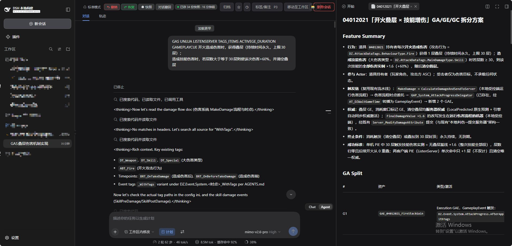
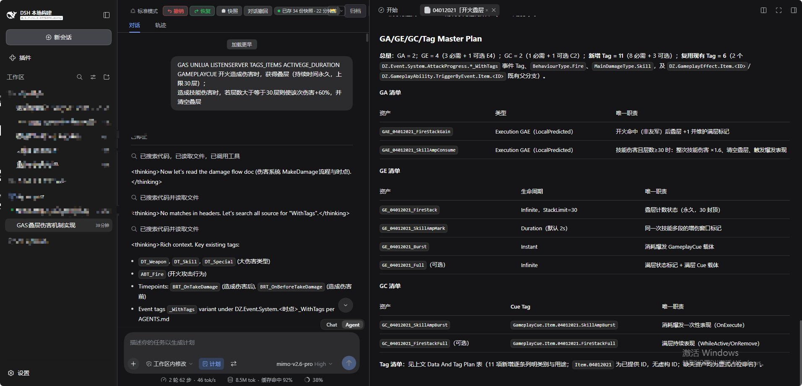

# dsh-gas-plan

[中文](README.md) | [English](README.en.md)

> **公开展示与访问申请仓库**。插件源码、捆绑 Skill 和项目参考资料保留在独立的私有仓库中，不会出现在这里。

`dsh-gas-plan` 是一个面向 **DZProject（Unreal Engine 5.8）** 的 DSH profile bundle，为玩法需求提供具备 Gameplay Ability System（GAS）上下文的规划约定。

它新增 `/plan-gas` 命令，不替换 DSH 内置 `/plan`，也不改变计划模式自身的状态机。

## 能力概览

- 通过 `/plan-gas <玩法需求>` 进入 DSH 内置计划模式。
- 注入 GAS Core 约定，覆盖 GA 激活与结束、GE 状态和生命周期、GC 表现边界。
- 默认启用 UnLua、ListenServer、GameplayTag 与物品、ActiveGE 持续时间、GameplayCue 五类知识预设。
- 捆绑 `dz-gas-split` Skill，要求输出 GA/GE/GC/Tag Master Plan。
- 强制关注 UE 5.8 的 GameplayEvent、预测、网络复制、Lua 边界、Duration GE 与 ReplicationID 规则。

## 测试案例

以下截图来自使用 **Mimo v2.6 Pro High** 运行的计划模式测试。

测试需求为物品 `04012021` 的开火叠层机制：开火命中后叠加永久层数（上限 30 层）；满层后，满足条件的技能伤害获得增幅并消耗层数。

### Feature Summary 与 GA 拆分

模型先检查已有伤害、事件和 Tag 流程，再给出参与者、触发链、权威端、终止条件与 GA 拆分：

### GA/GE/GC/Tag Master Plan

最终计划汇总 GA、GE、GC 与 Tag 数量，并为每个提议资产列出唯一职责、生命周期、可选项和缺失占位符：

## 申请访问私有源码仓库

实际插件源码位于私有仓库，仅对获授权用户开放。

如需评估、使用或参与协作，请在本仓库创建 [访问申请 Issue](../../issues/new?template=access-request.md)，并提供：

1. GitHub 用户名；
2. 使用目的与预期场景；
3. 是否只需要读取/安装权限，或需要贡献代码的写入权限；
4. 所属团队或项目（可选）。

审核通过后，会将你的 GitHub 账号加入组织并授予对应团队权限：

- **Read**：可拉取与安装私有插件；
- **Write**：可拉取、推送并参与协作。

> 请不要在 Issue 中提交 Token、密码、私钥或其他凭据。

## 边界

本公开仓库仅用于展示、案例说明和访问申请；不提供可 clone 的插件源码、私有 Skill 或项目参考文档。
